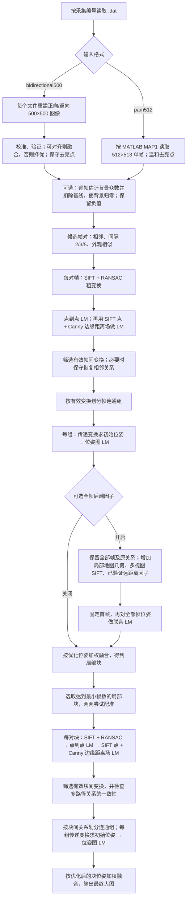

# 二维光声血管图像拼接

将一组光声 `.dat` 文件读取或恢复为二维图像，并拼接为一张或多张大图。支持旧双向扫描恢复，以及新 PAM 数据的 MATLAB MAP1 读取方式；两种输入共用逐帧配准、位姿图优化、局部块融合和块间拼接。每个 `.dat` 文件对应一个全局采集位置。

当前默认流程在**帧间和块间**都使用 SIFT 点到点 LM，以及 SIFT 点与 Canny 血管边缘距离场共同约束的第二次 LM；两级处理方式一致。块间精化改动只影响第二阶段，不需要重新恢复 `.dat` 或生成局部块。本数据集的 1301 份文件已完成全量局部块重跑；使用这些局部块重跑新版块间阶段后，仍是 7 个块、1083 份文件组成一张 3050×3010 大图，与旧版视觉效果基本一致。旧版正式结果未被覆盖，路径、数值对比及校验值见 [STABLE_RELEASE.md](STABLE_RELEASE.md)。

## 算法流程



点到点/边缘距离 LM 优化的是**一对图像间的变换**；位姿图 LM 优化的是**一个连通组内各帧或各块的摆放位姿**，使其预测的相对变换接近前一步测得的变换。没有可信关系连接的组分别输出，不强行拼接。块间边缘距离精化可用 `--no-refine-geometry` 关闭。

在本数据集的同一批局部块上，新旧块间配置的最终图尺寸和入图文件数相同，块位姿最大平移分量差约 0.69 像素，共同覆盖区域的浮点强度平均绝对差约 0.000745。边缘匹配指标略有改善，但没有证据表明最终大图质量明显提升；启用新版默认配置是为了保持两级配准方法一致，而不是宣称它在该数据集上显著优于旧版。新版结果在 `outputs/tile_edge_refinement_20261006/`，旧配置可用 `--no-refine-geometry` 复现。

## 1. 输入数据要求

默认输入格式为 `bidirectional500`，支持原项目的双向采集数据：

- 每个 `.dat` 文件先有 **8 字节头**，随后是 **500×1000 个小端 float64** 数值。
- 数值按 MATLAB 列优先顺序排列；前后各 500 列分别是正向、返向扫描。恢复后每向为 500×500 像素。
- 文件名中要有唯一的整数采集编号，代表采集顺序。默认识别 `1_Col2_tdT_58_scan1.dat` 这样的名称，其中 `scan1` 是扫描批次。
- 可用 `--filename-regex` 适配其他文件名。正则表达式必须包含命名组 `(?P<index>...)`，可选 `(?P<scan>...)`；不提供 `scan` 时所有文件视为同一批次。编号不能重复。
- 扫描日志可选。`--logs` 读取本项目格式的日志目录，或重复使用 `--log` 指定文件。没有日志仍可运行；日志时间戳不参与配准。

如果数据不属于本文支持的两种格式，矩阵尺寸、数值类型、头长度、列顺序或扫描布局不同，单换文件名规则不够，需要添加相应读取方式并重新验证。新数据集应先人工检查几张恢复帧的方向、强度和血管结构。

另支持 `--input-format pam512`：按新数据附带的 `PAMreadtoMsCamPA.m` 独立读取。文件头是两个小端 int32（1024、512），随后是 512×1024 个小端 float64，仍按 MATLAB 列优先顺序排列。严格复现 `MAP(:,512:1024)`，输出 **512×513** 单帧；保留脚本包含的边界列，不转置、不翻转、不做旧数据的余弦轨迹重采样或正返融合。

读取后默认复用 `denoise.py` 的温和去亮点参数：相对局部中值的强度差阈值 0.02、连通面积不超过 4 像素、宽高不超过 4 像素、3×3 中值窗口。2026-10-10 按用户选择恢复逐帧背景归零版本：在单帧第 0.5～70 百分位范围建立 256 格直方图，高斯平滑（标准差 2 格）后取众数作为背景基线，从整帧扣除该值。常量帧扣除其常量值。浮点负值保留，不截零。该估计不是血管分割，预览下限为零时暗于背景的信号仍会显示为黑色。

背景校正对两种格式都可选，默认开启：读取适配器完成恢复、去亮点后执行，再进入帧间配准；旧格式内部正返验证和校准不变。开启时配准和预览固定窗口为旧格式 0～0.25、新格式 0～0.06；关闭时为旧格式 0.02～0.25、新格式 0～0.06。块级读取第一阶段报告的窗口，不重复扣背景。当前不再使用自适应背景对齐或自动窗口，Gamma 1.6 仅保留为历史展示对照，未设为默认。

当前缓存直接保存实际参与配准和融合的预处理浮点帧：开启时已经扣除背景基线，`cache_frame_stage` 为 `after_background_correction`；关闭时为 `after_reader`。报告中 `background_baseline` 记录实际扣除值，关闭时为 0；不要对缓存再次扣除。改变算法或开关请使用新目录，历史自适应版本的缓存阶段不同，不能混用。

使用 `--background-correction` 明确开启（默认），使用 `--no-background-correction` 关闭；新格式同时加 `--no-suppress-speckles` 才得到纯 MATLAB 读取结果（转换为 float32）。例如 `pam-mosaic --data /data/scan --output /data/result --no-background-correction`。复现旧稳定版时，第一阶段必须加 `--no-background-correction`，第二阶段使用 `--no-refine-geometry`。后续候选关系、两次局部 LM、位姿图 LM 和加权融合均复用现有算法。

## 2. 环境与安装

需要 Python 3.10 或更新版本，依赖为 NumPy、SciPy、OpenCV。建议在独立 Python 环境中，从仓库根目录执行：

数值复现需保持库版本一致：本机旧数据稳定结果使用 `/home/gsp/miniconda3/envs/vision/bin/python`（NumPy 2.4.4、SciPy 1.17.1、OpenCV 4.13.0）。2026-10-10 验证发现基础环境的其他版本会改变旧数据正返校准/恢复结果，不能把由此产生的大图差异归因于后端因子。严格对照使用同一环境、同一单帧数组和同一前端关系。

```bash
python -m pip install -e .
python -m unittest discover -s tests -q
```

安装后有两个正式命令：`pam-mosaic`（恢复与局部块）和 `pam-stitch-tiles`（块间拼接）。若不安装，也可在仓库根目录用 `PYTHONPATH=src python -m pam_mosaic.cli` 和 `PYTHONPATH=src python -m pam_mosaic.backend.tile_stitch` 运行。目录重组后，已安装的旧环境需重新执行 `python -m pip install -e .` 以更新第二个入口。

## 3. 用新数据运行

以下以 `/data/new_scan` 为输入举例。输出目录由使用者指定；建议每组数据和每次参数调整都用新的目录。命令会拒绝覆盖已有 `report.json` 的完整结果。

```bash
pam-mosaic \
  --data /data/new_scan \
  --output /data/new_scan_result/components

pam-stitch-tiles \
  --components /data/new_scan_result/components \
  --output /data/new_scan_result/stitched \
  --min-frames 50
```

如果文件名是 `sample_001.dat`、`sample_002.dat`，第一步改为：

```bash
pam-mosaic \
  --data /data/new_scan \
  --filename-regex 'sample_(?P<index>\d+)\.dat' \
  --output /data/new_scan_result/components
```

本机新数据 `/home/gsp/PAM_brain/PAM` 的文件名是 `302.dat`～`870.dat`，使用新格式时自动识别纯数字文件名，无需重命名：

```bash
pam-mosaic \
  --input-format pam512 \
  --data /home/gsp/PAM_brain/PAM \
  --output /home/gsp/PAM_brain/outputs/pam512_full

pam-stitch-tiles \
  --components /home/gsp/PAM_brain/outputs/pam512_full \
  --output /home/gsp/PAM_brain/outputs/pam512_stitched
```

首次验证可在第一步增加 `--start 302 --stop 311`，第二步使用 `--min-frames 2`，并另选输出目录。第二步从第一步报告自动读取输入格式与强度窗口。新格式没有提供扫描批次，默认视为同一批次；如确有独立批次，应在文件名规则中提供 `scan` 组。

常用选项：

| 选项 | 作用 |
|---|---|
| `--input-format bidirectional500 / pam512` | 选择旧双向恢复流程或新 MATLAB MAP1 读取方式，默认旧格式。 |
| `--start N --stop M` | 仅处理编号 N～M 的文件，适合首次小规模检查。 |
| `--logs DIR` / `--log FILE` | 读取本项目格式的扫描日志；`--log` 可重复。 |
| `--no-frontend-recovery` | 关闭对断开相邻关系的保守重试。 |
| `--no-suppress-speckles` | 关闭轻度紧凑亮点处理。 |
| `--background-correction` / `--no-background-correction` | 开启 / 关闭逐帧背景归零校正，默认开启；旧稳定版复现必须关闭。 |
| `--pam512-speckle-excess 0.04` | 新格式亮点相对局部中值的检测阈值，默认 0.02；0.04 可用于减少过滤的对照实验，默认不变。 |
| `--temporal-window N` | 调整短间隔候选关系范围，默认 5。 |
| `--appearance-neighbors N` | 调整外观候选数，默认 6。 |
| `--backend-factors none / all` | 默认 `none` 保持原流程；`all` 保留全部帧和原关系并增加三类后端因子。也可用逗号选择 `geometry,intensity,loop` 中的部分因子。 |
| `pam-stitch-tiles --min-frames N` | 选择进入块间拼接的最小局部块文件数，默认 50。小样本检查可临时降到 2。 |
| `pam-stitch-tiles --no-cycle-gating` | 关闭块间闭合一致性筛选；正式流程保持默认开启。 |
| `pam-stitch-tiles --no-refine-geometry` | 关闭块间 Canny 边缘距离精化，复现此前稳定版配置；默认开启。 |

两步命令均提供 `--help`。首次可用 `--start/--stop` 处理约 10 份文件，再用 `--min-frames 2` 检查程序是否跑通。子集会重新估计校准参数，不能用来严格比较全量图像质量。

第一步支持中断后在相同数据、配置、代码和环境下复用 `.run_cache/` 的恢复帧与配准记录。源码、输入文件或数值库变化时，缓存会拒绝复用；请改用新输出目录。第二步会重新做块间配准和融合。报告中的组件路径由当前命令保存为绝对路径。

## 4. 输出与判断

### 可选全帧后端因子（2026-10-10）

正式入口提供 `--backend-factors all`，默认 `none` 仍可复现原流程。保留每一帧作为独立位姿变量，保留所有原前端关系；先求原位姿图解，再构建新增因子并联合优化。**不选择关键帧，不让普通帧跟随关键帧，不使用滑动窗口。**背景校正是独立开关，融合仍为羽化加权。

- `geometry`：从相邻局部地图的 Canny 边缘建立局部线结构，当前帧边缘点到线的鲁棒 LM 估计附加相对位姿；局部地图不含当前帧。
- `intensity`：沿用论文迁移中的名称，实际是多个邻帧的 SIFT 外观匹配点约束，用点到点 LM 估计附加相对位姿；**不是直接最小化像素灰度差，也不是联合优化地图点的完整 BA**。
- `loop`：寻找原图中没有的远距离关系，通过 SIFT、双向配准一致性、重叠、相关性及特征分布检查后加入。

几何/强度局部地图在采集序列前后 30 帧内选择，最多 6 个重叠邻帧；每帧最多检查 3 个远距离候选。测量权重和筛选阈值沿用 PAM512 全帧试验，没有为旧数据另行调参。各连通组独立运行，不靠新增因子强行连接原本断开的组；之后按原方法做块间配准、块级优化和融合。附加测量由初始全帧解一次性构建，再作为相对位姿边进入鲁棒 LM；不是实时 SLAM，也不是反复重建局部地图的全量联合求解。

旧数据关闭背景校正的运行方式：

```bash
pam-mosaic --data /home/gsp/PAM_brain/PAM_Skull_FYH_20260929 \
  --no-background-correction --backend-factors all \
  --output /home/gsp/PAM_brain/outputs/legacy_allframe_factors_full_20261010
pam-stitch-tiles \
  --components /home/gsp/PAM_brain/outputs/legacy_allframe_factors_full_20261010 \
  --output /home/gsp/PAM_brain/outputs/legacy_allframe_factors_stitched_20261010
```

每个局部块额外保存 `poses_baseline_xytheta.npy`（未加因子的全帧解）和 `backend_factors.json`（新增边、筛选记录及节点到文件编号映射），便于复查和回退。`poses_xytheta.npy` 是实际用于融合的最终位姿。只关闭因子时使用 `--backend-factors none`，不要同时改变背景或融合方式。

2026-10-10 旧数据全量实跑（`vision` 环境，1301 帧）：第一阶段 125 个连通块全部完成，新增因子 geometry 1191 条、intensity 1029 条、loop 0 条；第二阶段选 7 块、1083 帧，输出 3068×3006 单张大图，位于 `outputs/legacy_allframe_factors_stitched_20261010/`。与关闭因子的稳定版（`frontend_only_stitched/`，7 块、1083 帧、3050×3010）相比，块数和入图帧数完全相同，尺寸相差 18×4 像素。本次未做逐像素对照，不据此宣称质量改善。

因子对组内位姿的实际改动很小：多数帧位移在 0.001～0.02 像素量级，个别帧达到数像素。最大位移出现在 215 帧的 component_002，其中仅文件 133 一帧移动 6.575 像素（旋转 0.034°），其余 214 帧不超过 0.068 像素；270 帧的 component_024 最大 0.068 像素。这与新增边权重只有 0.35、原边全部保留、因子的局部地图以未加因子的解为基准一致。

本次 geometry 与 intensity 逐帧尝试建边，loop 因子在该数据上**全部未通过配对验证**：最大组件的 28 条远距离候选全部止于 `pair_validation`（`register` 阶段内点数不足 30 或中位误差超过 2.5 像素），未进入循环一致性检查。因此本例的因子效果只来自 geometry 与 intensity 两类，不能用它评估 loop 逻辑。

先前关键帧实验把 569 帧简化为 262 个关键帧，加入三类因子后的诊断误差中位数为 2.559 像素，原版为 1.773 像素。随后又尝试不使用关键帧，保留全部 569 个帧节点及 2286 条原有关系，额外增加 544 条几何因子、569 条强度因子、113 条通过验证且不重复的远距离约束。相同 38 对诊断帧对结果如下：

| 方案 | 误差中位数（像素） | P90（像素） |
|---|---:|---:|
| 原后端 | 1.773269 | 2.776849 |
| 全帧＋几何 | 1.773296 | 2.777219 |
| 全帧＋强度 | 1.773635 | 2.780391 |
| 全帧＋新增远距离约束 | 1.799306 | 2.919222 |
| 全帧＋全部新增因子 | 1.799049 | 2.888902 |

此前仅凭诊断误差略升而认定“全部因子没有改善”并回退，结论不充分，现已修正：**全帧＋全部因子在 PAM512 下部血管区域明显减轻模糊和拖影，其余大部分区域变化较小，当前目视检查未找到明确的明显退化区域。**表中诊断误差不等同于融合清晰度，不能用它否认局部改善，也不以锐度单项证明几何准确。诊断帧对排除了新增直接对应关系，但仍可能间接共享图像特征；结果不是独立真值。历史试验排除了这 38 对直接新增关系，通用入口不依赖本机诊断集，因此不保证与历史试验逐像素相同。未通过调参搜索挑选有利结果。

可复用的全帧实现位于 `backend/allframe.py` 和 `backend/factors.py`。历史关键帧方案及冻结的试验实现仍归档在 `experiments/retired_backend/`，历史对照脚本为 `experiments/compare_allframe_backend.py` 和 `experiments/compare_keyframe_backend.py`。全帧结果及同坐标图片见 `outputs/pam512_allframe_backend_20261010/`；原关键帧试验结果仍在 `outputs/pam512_backend_comparison_20261010/`。原始数据及先前稳定输出未修改。

第一步在 `components/` 生成 `component_001/` 等局部块及 `report.json`；小块与孤立帧也会保留。第二步在 `stitched/` 下生成 `mosaic_001/` 等大图及 `report.json`。若块之间没有可靠关系，可能得到多张大图，而不是强行拼成一张。

| 文件 | 含义 |
|---|---|
| `mosaic_float64.npy` | 浮点强度图；后续定量分析从这里读取。 |
| `weight_map.npy` | 融合权重和有效覆盖；权重大于 0 的位置有数据。 |
| `mosaic_preview.png` | 固定强度窗口的 HOT 彩色预览，只用于观看。 |
| `preview_window.json` | 实际预览窗口、有效像素数和窗口外像素比例；与 `report.json` 中的配准窗口区分。 |
| `poses_xytheta.npy` | 局部块内逐文件位姿，平移单位为像素，旋转单位为弧度。 |
| `tile_poses_xytheta.npy` | 最终大图中的局部块位姿。 |
| `report.json` | 输入编号、分量、匹配和处理决策。 |
| `.run_cache/` | 第一阶段缓存，可用于条件完全相同时继续未完成的运行。 |

全量处理文件数不等于最终入图文件数。没有可靠对应关系时，程序保留断开的局部块。相关性、边缘距离和接缝检查只能作为图像证据，不证明解剖身份；目前也没有物理像素标定，不能直接把像素换算为毫米。

### 新 PAM 数据全量验证（2026-10-08）

本机 `PAM/302.dat`～`870.dat` 共 569 帧已完成全流程。读取严格遵循 MATLAB 的列优先排列及第 512～1024 列裁剪，每帧为 512×513。上一版强制背景归零结果保留为对照：`outputs/pam512_background_full_20261008/`（缓存已扣背景）及 `outputs/pam512_background_stitched_20261008/mosaic_001/`。

该次运行使用 `--pam512-speckle-excess 0.04`，背景校正开启；569 帧全部进入一个块，2287 对候选中 2286 对有效，最终宽 1315、高 1897。逐帧估计背景约为 −0.01176～−0.00775，指定区域的弱血管可见性改善，同时背景稍亮、局部仍有软化。第二阶段只有一个块，无需额外块间配准。25 项自动测试通过，原始采集数据未修改。

按用户要求，2026-10-08 已删除此前 PAM 的试跑、阈值/亮度对照、局部诊断、重复全量结果及临时比较脚本，释放约 1.44 GB；删除清单见本机 `outputs/cleanup_pam_20261008.json`。这些文件未进入回收站，相关历史聊天中的对照图片链接已失效。旧数据的稳定输出保留。

### 自适应背景策略试验（2026-10-08～09，历史试验，当前已恢复归零版）

完整重跑 569 帧，全部进入一个连通块；2285 对候选、2275 对有效，最终宽 1303、高 1895。第二阶段只有一个块，无需块间配准。亮点阈值仍为 0.04，Canny 参数未改（输入视图变化仍可能影响边缘结果）。32 项测试通过。

本组参考背景约 −0.011694，**实际校正 0 帧**：53 帧背景估计不够可信，516 帧偏移未超过不确定度。因此这次主要变化来自不再强制归零和自动窗口，并非执行了更强的背景扣除。配准窗口为 −0.048828～0.097656；最终预览约 −0.023019～0.053655，低于预览下限的有效像素约 0.093%。

- `outputs/pam512_adaptive_background_full_20261008/`：新全流程及 569 帧未做背景对齐的缓存。
- `outputs/pam512_adaptive_background_stitched_20261008/mosaic_001/`：最终数值图、预览及窗口记录。
- `outputs/pam512_adaptive_background_comparison_20261008/`：全图、指定血管区域三列对照；依次为上一版、新处理固定旧位姿、新处理完整重配准。`fixed_old_poses/` 保留固定几何的数值对照，分离显示/预处理与配准影响。

局部暗部更可见，但背景也更灰，部分血管对比降低，融合软化仍存在；尚不能认为整体优于上一版，更不能据此断言恢复了真实缺失血管。两版均保留。

2026-10-09 已用当前策略重新跑完旧双向数据 1301 帧：5936 对候选、47 条相邻补救、144 个局部连通块；8 个达到 50 帧门槛的大块合成 3087×3002 大图，包含 1034 帧。组内参考背景约 0.039061，13 帧执行偏移校正，1284 帧偏移不显著，4 帧背景不可信。配准窗口约 0.002471～0.274712。结果见 `outputs/legacy_adaptive_background_full_20261009/` 和 `outputs/legacy_adaptive_background_stitched_20261009/`；Gamma 1.6 黑白/原 HOT 配色预览及三版对照见 `outputs/legacy_adaptive_background_comparison_20261009/`。Gamma 仅用于这些展示图，未改数值融合及默认预览。最终入图比原稳定结果少 49 帧、比历史强制归零结果少 17 帧；小块仍在第一阶段保留，不能认定此次处理整体更好。

运行当前归零版本（该命令不复现上面的自适应试验）：

```bash
pam-mosaic --input-format pam512 --pam512-speckle-excess 0.04 \
  --data /home/gsp/PAM_brain/PAM \
  --output /home/gsp/PAM_brain/outputs/pam512_background_full_new
pam-stitch-tiles \
  --components /home/gsp/PAM_brain/outputs/pam512_background_full_new \
  --output /home/gsp/PAM_brain/outputs/pam512_background_stitched_new
```

正式融合仍使用浮点加权平均。拉普拉斯多频段与接缝选择已做实验对照（见 `experiments/README.md`），但没有替换正式融合；泊松融合未接入。后端因子对照保持原羽化方式，避免把融合方式变化混入位姿优化的效果。

### 旧双向数据背景校正全量验证（2026-10-08，历史强制归零版本）

背景校正在正返处理和去亮点后执行，保留负残差，然后重新运行候选关系、帧间配准、两级位姿图及融合。旧格式校正后的配准和预览窗口使用 0～0.25；关闭校正可复现原 0.02～0.25 窗口。

- 第一阶段：`outputs/legacy_background_full_20261008/`，含全部 1301 帧校正缓存及 131 个连通块。
- 第二阶段：`outputs/legacy_background_stitched_20261008/mosaic_001/`，8 个大块、1051 帧进入 3088×3006 的最终图。
- 对比：`outputs/legacy_background_comparison_20261008/`，含全图、三处局部图和统计报告。全图保持各自原始几何，局部仅做显示用相似变换对齐。

本次 5924 对候选中 4461 对有效（含 54 条相邻补救），背景估计范围约 0.03709～0.04486，中位数 0.03923。原配置为 125 个局部块，7 个大块、1083 帧最终入图。新配置增加 1014 号帧，但 415～444、448、589、1055 共 33 帧未进入达到 50 帧门槛的大块，净减少 32 帧；它们仍保存在第一阶段局部块中。预览背景更干净，部分弱信号也更暗，尚未证明细血管整体更清楚或拼接更准确，因此原稳定版不被替换。25 项自动测试通过。

```bash
pam-mosaic --input-format bidirectional500 \
  --data /home/gsp/PAM_brain/PAM_Skull_FYH_20260929 \
  --output /home/gsp/PAM_brain/outputs/legacy_background_full_new
pam-stitch-tiles \
  --components /home/gsp/PAM_brain/outputs/legacy_background_full_new \
  --output /home/gsp/PAM_brain/outputs/legacy_background_stitched_new
```

## 5. 仓库结构：每个保留文件的用途

```text
README.md                         当前使用说明、格式与仓库结构
STABLE_RELEASE.md                 本数据集正式结果、已知限制和校验值
pyproject.toml                    依赖、打包配置与两个命令入口
.gitignore                        排除原始数据、输出、缓存及本机状态
src/pam_mosaic/
  __init__.py                      Python 包标记
  cli.py                          第一阶段命令行入口，自动识别读取适配器
  checkpoint.py                    输入/配置/代码绑定的恢复缓存
  pipeline.py                      第一阶段整体流程和报告
  preprocessing/                  数据预处理：读取、恢复、去亮点、背景校正
    __init__.py                   子包标记
    inputs.py                     自动发现输入格式及通用 InputState 接口
    dataset.py                    输入文件编号、扫描批次和日志索引
    reconstruction.py             旧双向 .dat 读取、拆分和扫描轨迹校正
    roundtrip.py                  旧正返内部校准、验证、融合或择优
    denoise.py                    通用紧凑亮点处理
    background.py                 可选逐帧背景众数估计及归零，保留浮点负值
    formats/                      每种采集格式一个适配文件，新数据在此添加
      __init__.py                 适配器目录标记
      bidirectional500.py         旧数据读取适配，组织 reconstruction 和 roundtrip
      pam512.py                   新 PAM 格式读取、MATLAB MAP1 裁剪与温和去亮点
  frontend/                       前端：测量一对图像之间的相对变换
    __init__.py                   子包标记
    view.py                       配准视图窗口映射，不修改科学浮点强度
    candidates.py                 时间邻近和外观相似候选帧对
    registration.py               SIFT/RANSAC、点到点/边缘距离 LM、相邻恢复
  backend/                        后端：利用多条关系优化全局摆放并融合
    __init__.py                   子包标记
    graph.py                      由可信关系求帧/块连通组
    poses.py                      SE(2) 初始位姿传递与鲁棒位姿图优化
    fusion.py                     逐帧/块级浮点加权融合及预览
    tile_stitch.py                第二阶段块间关系、闭环筛选、优化、融合和入口
    allframe.py                   可选全帧后端，保留原图并生成、筛选和加入附加因子
    factors.py                    局部地图边缘点到线、多视图 SIFT 测量与可信度估计
tests/
  test_dataset.py                  文件名适配、编号和路径检查
  test_reconstruction.py           MATLAB 数据读取与轨迹校正检查
  test_pam512.py                   新格式头部、列优先排列、513 列裁剪及强度视图检查
  test_roundtrip.py                正返融合行为检查
  test_denoise.py                  亮点处理检查
  test_background.py               背景偏移校正、强度差及负值保留检查
  test_registration.py             配准与恢复检查
  test_poses.py                    位姿图优化检查
  test_allframe.py                 因子开关、保留原关系、背景独立性与信息矩阵雅可比检查
  test_fusion.py                   融合输出检查
  test_tile_stitch.py              块间一致性筛选检查
  test_checkpoint.py               缓存身份与续跑检查
  test_inputs.py                  输入适配器发现、新格式复用通用后续流程检查
docs/
  history/HANDOFF_20261006.md     本数据集历史排查交接记录
  experiments/IMPROVEMENT_PLAN_20261006.md  历史改进计划
```

两种输入的背景校正位置一致：`读取适配器完成单帧读取/恢复和去亮点 → 通用背景校正 → 前端帧间配准 → 后端连通组位姿优化与融合`。旧数据在读取适配器内部先完成正返扫描处理；块级阶段复用前端配准函数测量块间变换，再由后端优化，背景不会重复扣除。根目录只保留入口、流程组织和缓存基础设施，没有重复的算法实现。

2026-10-08 重组验证：28 项自动测试通过；两种数据各 10 帧的两阶段小样本流程均完成，逐帧预处理缓存与重组前对应全量结果逐元素一致，最大绝对差为 0。既有完整大图和原始数据未重新写入。

### 添加一组新采集格式

在 `src/pam_mosaic/preprocessing/formats/` 新建一个 `.py` 文件，参照现有适配器提供以下接口。`inputs.py` 自动发现它，CLI 的 `--input-format` 会自动增加选项，不需要改前端、后端或 `pipeline.py`。

| 成员 | 用途 |
|---|---|
| `FORMAT_NAME` | 命令行格式名称，必须唯一。 |
| `FILENAME_REGEX` | 带 `(?P<index>...)` 的编号规则，可选扫描批次 `scan` 组。 |
| `FILE_GLOB`（可选） | 文件筛选，例如 `*.npy`；默认 `*.dat`。 |
| `DISPLAY_RANGE` | 背景校正开启时的固定配准和预览窗口。 |
| `UNCORRECTED_DISPLAY_RANGE`（可选） | 关闭背景校正时的窗口；默认与上项一致。 |
| `prepare(paths)` | 准备读取状态，返回 `InputState()`；需校准时通过 `context` 保存状态，通过 `cache_config` 保存可序列化身份信息。 |
| `options(suppress_speckles, speckle_excess)` | 返回读取/去亮点配置字典，参与缓存身份检查；无特殊处理可返回 `{}`。 |
| `load_frame(path, state, configuration)` | 返回二维浮点单帧及处理记录字典，不在这里重复做通用背景校正。 |

最小示例（已恢复为二维 `.npy` 的输入）：

```python
import numpy as np
from ..inputs import InputState

FORMAT_NAME = "npy_frames"
FILENAME_REGEX = r"frame_(?P<index>\d+)\.npy"
FILE_GLOB = "*.npy"
DISPLAY_RANGE = (0.0, 0.06)  # 按实际数据确定，不要盲用示例范围

def prepare(paths):
    return InputState()

def options(suppress_speckles, speckle_excess):
    return {}

def load_frame(path, state, configuration):
    image = np.load(path, allow_pickle=False).astype(np.float32)
    if image.ndim != 2 or not np.isfinite(image).all():
        raise ValueError(f"Invalid frame: {path}")
    return image, {"selected": "npy", "changed_pixels": 0}
```

选择新格式即可：`pam-mosaic --input-format npy_frames --data /data/frames --output /data/result/components`，第二阶段的命令不变。每帧尺寸、方向和强度应一致；不同扫描布局需要适配器先恢复成一致的二维图像。目录重组改变了源码身份，原有完成结果仍能查看及用于第二阶段，但不能直接复用重组前的未完成第一阶段缓存。

原始数据目录和 `outputs/` 被 `.gitignore` 排除，不会随代码上传。`outputs/frontend_only_*` 是本机稳定结果；`outputs/lm_*` 是历史基线；`outputs/archived_experiments_20261006/code/` 保存移出工作代码的比较和实验脚本，仅供本机追溯。换机器时需自行提供原始数据和选择新的输出路径。

2026-10-07 已清理本机输出：保留当前配置与旧稳定版的完整最终数值图、全量局部块，以及 `outputs/stable_rerun_20261006_full/.run_cache/` 中的一份完整恢复缓存；重复重跑大图、旧基线和小规模试验的数值数组已删除，对比图片、报告及归档源码保留。精简后的历史目录不再是完整可续跑结果。具体保留内容见本机 `outputs/README.md`，删除清单见 `outputs/cleanup_20261007.json`。
