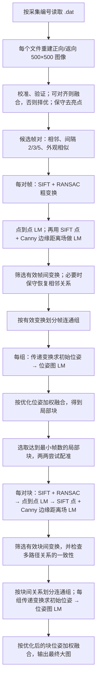

# 二维光声血管图像拼接

将一组双向扫描的光声 `.dat` 文件恢复为二维图像，并拼接为一张或多张大图。处理流程包括正返扫描校准与验证、轻度亮点处理、逐帧配准与位姿图优化、局部块融合、块间配准与位姿图优化。每个 `.dat` 文件对应一个全局采集位置。

当前默认流程在**帧间和块间**都使用 SIFT 点到点 LM，以及 SIFT 点与 Canny 血管边缘距离场共同约束的第二次 LM；两级处理方式一致。块间精化改动只影响第二阶段，不需要重新恢复 `.dat` 或生成局部块。本数据集的 1301 份文件已完成全量局部块重跑；使用这些局部块重跑新版块间阶段后，仍是 7 个块、1083 份文件组成一张 3050×3010 大图，与旧版视觉效果基本一致。旧版正式结果未被覆盖，路径、数值对比及校验值见 [STABLE_RELEASE.md](STABLE_RELEASE.md)。

## 算法流程



点到点/边缘距离 LM 优化的是**一对图像间的变换**；位姿图 LM 优化的是**一个连通组内各帧或各块的摆放位姿**，使其预测的相对变换接近前一步测得的变换。没有可信关系连接的组分别输出，不强行拼接。块间边缘距离精化可用 `--no-refine-geometry` 关闭。

在本数据集的同一批局部块上，新旧块间配置的最终图尺寸和入图文件数相同，块位姿最大平移分量差约 0.69 像素，共同覆盖区域的浮点强度平均绝对差约 0.000745。边缘匹配指标略有改善，但没有证据表明最终大图质量明显提升；启用新版默认配置是为了保持两级配准方法一致，而不是宣称它在该数据集上显著优于旧版。新版结果在 `outputs/tile_edge_refinement_20261006/`，旧配置可用 `--no-refine-geometry` 复现。

## 1. 输入数据要求

程序支持与本项目相同的原始采集格式：

- 每个 `.dat` 文件先有 **8 字节头**，随后是 **500×1000 个小端 float64** 数值。
- 数值按 MATLAB 列优先顺序排列；前后各 500 列分别是正向、返向扫描。恢复后每向为 500×500 像素。
- 文件名中要有唯一的整数采集编号，代表采集顺序。默认识别 `1_Col2_tdT_58_scan1.dat` 这样的名称，其中 `scan1` 是扫描批次。
- 可用 `--filename-regex` 适配其他文件名。正则表达式必须包含命名组 `(?P<index>...)`，可选 `(?P<scan>...)`；不提供 `scan` 时所有文件视为同一批次。编号不能重复。
- 扫描日志可选。`--logs` 读取本项目格式的日志目录，或重复使用 `--log` 指定文件。没有日志仍可运行；日志时间戳不参与配准。

如果新数据的矩阵尺寸、数值类型、头长度、列顺序或正返布局不同，单换文件名规则不够，需要修改 `reconstruction.py` 并重新验证恢复结果。新数据集应先人工检查几张恢复帧的方向、强度和血管结构。

## 2. 环境与安装

需要 Python 3.10 或更新版本，依赖为 NumPy、SciPy、OpenCV。建议在独立 Python 环境中，从仓库根目录执行：

```bash
python -m pip install -e .
python -m unittest discover -s tests -q
```

安装后有两个正式命令：`pam-mosaic`（恢复与局部块）和 `pam-stitch-tiles`（块间拼接）。若不安装，也可在仓库根目录用 `PYTHONPATH=src python -m pam_mosaic.cli` 和 `PYTHONPATH=src python -m pam_mosaic.tile_stitch` 运行。

## 3. 用新数据运行

以下以 `/data/new_scan` 为输入举例。输出目录由使用者指定；建议每组数据和每次参数调整都用新的目录。命令会拒绝覆盖已有 `report.json` 的完整结果。

```bash
pam-mosaic \
  --data /data/new_scan \
  --output /data/new_scan_result/components

pam-stitch-tiles \
  --components /data/new_scan_result/components \
  --output /data/new_scan_result/stitched \
  --min-frames 50
```

如果文件名是 `sample_001.dat`、`sample_002.dat`，第一步改为：

```bash
pam-mosaic \
  --data /data/new_scan \
  --filename-regex 'sample_(?P<index>\d+)\.dat' \
  --output /data/new_scan_result/components
```

常用选项：

| 选项 | 作用 |
|---|---|
| `--start N --stop M` | 仅处理编号 N～M 的文件，适合首次小规模检查。 |
| `--logs DIR` / `--log FILE` | 读取本项目格式的扫描日志；`--log` 可重复。 |
| `--no-frontend-recovery` | 关闭对断开相邻关系的保守重试。 |
| `--no-suppress-speckles` | 关闭轻度紧凑亮点处理。 |
| `--temporal-window N` | 调整短间隔候选关系范围，默认 5。 |
| `--appearance-neighbors N` | 调整外观候选数，默认 6。 |
| `pam-stitch-tiles --min-frames N` | 选择进入块间拼接的最小局部块文件数，默认 50。小样本检查可临时降到 2。 |
| `pam-stitch-tiles --no-cycle-gating` | 关闭块间闭合一致性筛选；正式流程保持默认开启。 |
| `pam-stitch-tiles --no-refine-geometry` | 关闭块间 Canny 边缘距离精化，复现此前稳定版配置；默认开启。 |

两步命令均提供 `--help`。首次可用 `--start/--stop` 处理约 10 份文件，再用 `--min-frames 2` 检查程序是否跑通。子集会重新估计校准参数，不能用来严格比较全量图像质量。

第一步支持中断后在相同数据、配置、代码和环境下复用 `.run_cache/` 的恢复帧与配准记录。源码、输入文件或数值库变化时，缓存会拒绝复用；请改用新输出目录。第二步会重新做块间配准和融合。报告中的组件路径由当前命令保存为绝对路径。

## 4. 输出与判断

第一步在 `components/` 生成 `component_001/` 等局部块及 `report.json`；小块与孤立帧也会保留。第二步在 `stitched/` 下生成 `mosaic_001/` 等大图及 `report.json`。若块之间没有可靠关系，可能得到多张大图，而不是强行拼成一张。

| 文件 | 含义 |
|---|---|
| `mosaic_float64.npy` | 浮点强度图；后续定量分析从这里读取。 |
| `weight_map.npy` | 融合权重和有效覆盖；权重大于 0 的位置有数据。 |
| `mosaic_preview.png` | 固定强度范围 0.02～0.25 的彩色预览；只用于观看。 |
| `poses_xytheta.npy` | 局部块内逐文件位姿，平移单位为像素，旋转单位为弧度。 |
| `tile_poses_xytheta.npy` | 最终大图中的局部块位姿。 |
| `report.json` | 输入编号、分量、匹配和处理决策。 |
| `.run_cache/` | 第一阶段缓存，可用于条件完全相同时继续未完成的运行。 |

全量处理文件数不等于最终入图文件数。没有可靠对应关系时，程序保留断开的局部块。相关性、边缘距离和接缝检查只能作为图像证据，不证明解剖身份；目前也没有物理像素标定，不能直接把像素换算为毫米。

## 5. 仓库结构：每个保留文件的用途

```text
README.md                         当前使用说明、格式与仓库结构
STABLE_RELEASE.md                 本数据集正式结果、已知限制和校验值
pyproject.toml                    依赖、打包配置与两个命令入口
.gitignore                        排除原始数据、输出、缓存及本机状态
src/pam_mosaic/
  __init__.py                      Python 包标记
  cli.py                           第一阶段命令行入口
  dataset.py                       输入文件编号、扫描批次和日志索引
  reconstruction.py                .dat 读取、正返拆分和扫描轨迹校正
  roundtrip.py                     正返内部校准、验证、融合或择优
  denoise.py                       保守的紧凑亮点处理
  registration.py                  SIFT、RANSAC、距离场精化和相邻恢复
  graph.py                         候选配准关系和连通分量
  poses.py                         SE(2) 位姿表示与鲁棒位姿图优化
  fusion.py                        逐帧融合、块级融合及预览
  checkpoint.py                    输入/配置/代码绑定的恢复缓存
  pipeline.py                      第一阶段整体流程和报告
  tile_stitch.py                   第二阶段块间配准、筛选、融合及命令入口
tests/
  test_dataset.py                  文件名适配、编号和路径检查
  test_reconstruction.py           MATLAB 数据读取与轨迹校正检查
  test_roundtrip.py                正返融合行为检查
  test_denoise.py                  亮点处理检查
  test_registration.py             配准与恢复检查
  test_poses.py                    位姿图优化检查
  test_fusion.py                   融合输出检查
  test_tile_stitch.py              块间一致性筛选检查
  test_checkpoint.py               缓存身份与续跑检查
docs/
  history/HANDOFF_20261006.md     本数据集历史排查交接记录
  experiments/IMPROVEMENT_PLAN_20261006.md  历史改进计划
```

原始数据目录和 `outputs/` 被 `.gitignore` 排除，不会随代码上传。`outputs/frontend_only_*` 是本机稳定结果；`outputs/lm_*` 是历史基线；`outputs/archived_experiments_20261006/code/` 保存移出工作代码的比较和实验脚本，仅供本机追溯。换机器时需自行提供原始数据和选择新的输出路径。
