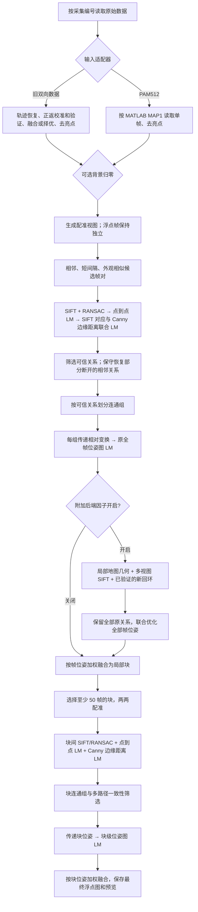

# 当前二维光声拼接算法

当前确认流程以每帧的二维刚体位姿为变量，保留所有可信前端关系，再加入几何、多视图 SIFT 和回环因子，最后做两级加权融合。代码中的附加因子仍可关闭；复现当前配置时使用 `--backend-factors all`。运行与数据格式说明见 [README](../README.md)。

## 1. 完整流程

两级位姿都只包含平移 `x, y` 和旋转 `theta`。所有帧都可以独立调整，没有关键帧选择或普通帧跟随关键帧。附加因子在原有帧连通组内部生成；未连接的帧组由后续块级阶段尝试连接。

## 2. 读取、预处理与强度视图

读取代码位于 `preprocessing/formats/`，返回实际参与融合的 float32 二维帧。

- 旧格式：恢复正、返扫描的轨迹，校准返向，再按每文件的配准证据融合两向或择优。正返阶段和单帧去亮点在适配器内部完成。
- PAM512：按照 MATLAB 列优先排列读取，并严格取 `MAP(:,512:1024)`，得到 512×513 单帧；使用紧凑亮点过滤。
- 通用背景校正：在读取、去亮点之后执行，两种格式的位置相同。旧数据当前关闭，PAM512 当前开启。

背景归零在单帧的第 0.5～70 百分位范围内建立 256 格直方图，以标准差 2 格的高斯滤波平滑计数，取众数峰中心为基线 `b`：

\[
I_{\mathrm{corrected}}(p)=I(p)-b.
\]

常量帧直接扣除其常量值。负值保存在浮点帧和融合图中；显示窗口映射时才发生截断。该估计并非血管分割，暗于显示下限的血管仍可能在预览中变黑。

配准使用固定强度窗口的映射视图，SIFT/Canny 使用相应 8 位图；融合使用浮点帧，不从 PNG 恢复强度。当前窗口为旧数据关闭背景时 0.02～0.25、PAM512 0～0.06。块级阶段沿用帧级窗口，不重复校正背景。

## 3. 前端：一对图像的相对配准

默认候选包含相邻帧、间隔 2/3/5 帧，以及模糊降采样外观描述相似度至少 0.65 的远距离帧；每帧最多检索 6 个外观候选。相邻关系通常提供较多重叠，远距离候选补充重复扫描区域的约束，但候选本身不代表配准成功。

对参考帧 `i`、移动帧 `j`，测量 `Z_ij` 将 `j` 的像素坐标变换到 `i`：

1. SIFT 描述匹配（最多 1200 特征、比值阈值 0.75）与 RANSAC（3 像素阈值）筛选对应点；从粗估计提取刚体变换，不保留缩放。
2. 用对应点的点到点残差做鲁棒 LM。
3. 在 SIFT 对应残差之外，采样移动图的 Canny 边缘点，计算其变换到参考图后的边缘距离，联合做第二次 LM。Canny 为 35/90；额外边缘项权重为 0.3，距离截断为 20 像素，最多采样 350 个边缘点。

设 SIFT 对应为 `p_k`（移动）、`q_k`（参考），参考图边缘距离场为 `D_i`，移动图的 Canny 采样点为 `e_l`，联合残差为：

\[
r(Z_{ij})=\begin{bmatrix}
\{Z_{ij}p_k-q_k\}_k\\
\{0.3\min(D_i(Z_{ij}e_l),20)\}_l
\end{bmatrix}.
\]

LM 对残差的每个分量使用阈值 2 的 Huber 目标。这里的边缘点来自 Canny；SIFT 对应保留点到点约束，避免只按边缘位置吸附到相似血管。

默认至少 12 个 RANSAC 内点，最终对应点误差中位数不超过 5 像素、重叠至少 0.15 才保留关系。对于原本断开、同扫描批次的相邻帧，可以使用增强 SIFT 或严格受限的弱信号平移重试。只有成功的关系参与连通组划分。

## 4. 原全帧位姿图与初始化

每个帧连通组独立求解。设 `T_i` 为帧 `i` 的像素到组坐标的变换，关系预测为 `T_i^{-1}T_j`，应接近测量 `Z_ij`。

先把组内第一帧固定为单位位姿，沿可信边传播：已知 `T_i` 时有 `T_j=T_i Z_ij`，反向传播则乘逆变换。初始化只需要有一条路径到锚点；额外路径由优化共同协调。

`poses.py` 的实际残差如下。令 `T_i=(R_i,t_i)`、`Z_ij=(R_z,t_z)`，角度分别为 `theta_i, theta_j, theta_z`：

\[
g_{ij}=\begin{bmatrix}
R_z^T\big(R_i^T(t_j-t_i)-t_z\big)\\
100\,\operatorname{wrap}(\theta_j-\theta_i-\theta_z)
\end{bmatrix},\qquad
r_{ij}=w_{ij}S_{ij}g_{ij}.
\]

普通前端边的 `S_ij` 为单位矩阵；附加几何/强度边使用估计的对角平方根信息矩阵。`w_ij` 是代码中的残差乘数，角度乘 100 用于与像素量级协调。优化目标是各残差分量的 Huber 和，而不是对整条三维残差范数直接取 Huber：

\[
\min_{T_1,\ldots,T_{n-1}}\sum_{(i,j)\in E}\sum_{d=1}^3
\rho_3\big(r_{ij,d}\big),\qquad T_0\text{固定}.
\]

稀疏解析雅可比与鲁棒 LM 用于求解。平移单位为像素，角度单位为弧度。这个目标比较的是整组位姿预测的相对变换与测得变换，不是直接对所有原始 SIFT 点再做一次全局点优化。

## 5. 附加全帧后端因子

`allframe.py` 以原全帧位姿图的解为初值，保留全部帧节点和原边。局部地图在采集序列前后 30 帧内按位置选择重叠邻帧，最多 6 帧，并且排除当前帧。以下测量从这份初始解一次性构建，再成为附加相对位姿边加入上一节的目标。

### 几何因子 `geometry`

每帧从 Canny 最多采样 700 个边缘点。把多个邻帧边缘投影到局部坐标，按 2 像素网格去重。为当前帧的边缘点查找最近 5 个地图点，通过局部 PCA 判断是否形成可信线结构。最近距离、邻域范围和特征值比例用于筛除不可靠对应。

在固定对应下，以局部法向 `n_l` 和中心 `c_l` 构建点到线残差：

\[
r_l^{\mathrm{geometry}}(Z)=n_l^T(Z e_l-c_l).
\]

至少 80 个有效残差才尝试鲁棒 LM。这里求得一个当前帧到参考邻帧的相对变换，随后作为附加位姿边加入整组优化。

### 多视图 SIFT 因子 `intensity`

代码沿用 `intensity` 名称，实际采用 SIFT 外观描述匹配的多视图点约束。至少两个邻帧提供对应，把它们的参考点投影到同一局部坐标；同一个当前帧特征的重复观测合并为平均目标，避免重复计权。

空间散列固定留出部分对应，剩余对应中初始偏差小于 8 像素的点参与求解，至少 24 个唯一特征。残差为：

\[
r_k^{\mathrm{intensity}}(Z)=Zp_k-\bar q_k.
\]

它是点到点鲁棒 LM，不是直接最小化逐像素灰度差，也不联合优化地图点。几何与多视图 SIFT 测量均检查可观测性、更新幅度和代价：平移更新最多 10 像素、角度最多 1.5°，并依据归一化雅可比和残差估计保守信息量。附加边残差权重均为 0.35。

### 回环因子 `loop`

在同一原连通组中检索与当前帧相隔超过 30 帧的历史候选，排除已有帧对，相似度至少 0.55；每帧最多检查 3 个候选。通过前端配准之后还要求：

- 至少 30 个内点，匹配误差中位数不超过 2.5 像素，特征分布足够分散。
- 正、反配准组合的平移误差小于 2 像素、角度小于 0.5°。
- 重叠大于 0.3，重叠区相关性大于 0.55。

通过后作为权重 0.7 的新相对位姿边加入；同一帧对不重复添加。开启回环不保证存在可接受回环，旧数据当前运行新增回环为 0。

## 6. 局部块与块级后端

帧级优化后先融合各连通组，连不上的组作为独立局部块保留。第二阶段默认选择不少于 50 帧的块，对这些块两两复用前端的 SIFT/RANSAC、点到点 LM 和 Canny 边缘距离 LM。

块图先选择高可信度的生成树，额外关系与树传播得到的相对变换进行一致性检查：闭合平移默认不超过 5 像素、角度不超过 0.2°才保留。各块连通组传递初始位姿，再复用相同位姿图残差做 LM，最后融合。只有一个块时不需要额外块间测量。

块级阶段优化的是块位姿，不重新调用帧级的局部地图附加因子模块。

## 7. 加权融合与数值保存

帧级权重来自距矩形边界的距离，在 35 像素处封顶，最小为 `1/35`。图像和权重按优化后的刚体位姿双线性投影到公共画布：

\[
M(p)=\frac{\sum_i\widetilde w_i(p)\widetilde I_i(p)}{\sum_i\widetilde w_i(p)}.
\]

块级同样使用加权平均，权重来自局部块保存的 `weight_map.npy`。权重为零的位置不贡献；最终浮点图以 float64 保存，预览使用固定窗口的 HOT 配色，Gamma 为 1。

该融合方式保留强度的加权平均意义，但插值与尚存的配准偏差仍可能使血管变软或重影。二维刚体模型不能消除所有局部形变；预览清晰度不等于解剖几何真值，浮点图与权重应一并用于后续分析。
